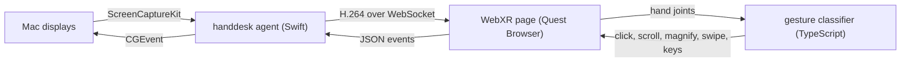

<!-- readme:header:start -->
<p>
  
  <a href="https://github.com/Egoushka/handdesk/actions/workflows/ci.yml"></a>
  
</p>
<!-- readme:header:end -->

# handdesk

> Use your Mac on a Meta Quest 3 with your hands: pinch to click, two fingers to scroll, three-finger swipes for Spaces, and a virtual keyboard you type on at your real desk.

<!-- readme:status:start -->
**Active**. I work on it this month.
<!-- readme:status:end -->

Meta's own Virtual Display forwards a pointer, scroll and a keyboard. It does not map hand gestures to macOS pinch-zoom, rotate or three-finger swipes, and I found no app that does. handdesk is a small agent on the Mac plus a web page in the Quest Browser (no APK, no store) that fills that gap.



## Why

I wanted a large desktop I can fly around in and work with my hands: click icons, drag scrollbars, switch Spaces, zoom, and type fast. Touching a real desk is what makes typing fast, so the keyboard lives on the desk surface, with a mid-air mode when there is no surface.

## What it does

- Renders each Mac display as a panel you can grab with two pinching hands, resize, turn and curve. Passthrough (AR) and a dark environment (VR) are one button apart.
- Hand tracking first, controllers as a fallback.
- Gestures (full table in [the spec](docs/specs/handdesk-v0.1.md)):

| Gesture | Mac result |
|---|---|
| Thumb-index pinch, release | left click (two quick pinches double-click) |
| Pinch, move, release | drag |
| Thumb-middle pinch | right click |
| Thumb touches index and middle, move the hand | smooth scroll |
| L shape (thumb and index out), change the gap | zoom (Cmd + / Cmd -) |
| Index, middle, ring out, swipe 10 cm | left/right: Ctrl-Left/Right (Spaces); up: Mission Control; down: App Expose |
| Both hands pinching | move, turn and resize the panel |
| Fingertip within 3 cm of a panel, then through it | touch: tap and drag, like a touchscreen |
| Flip the left wrist (palm down, up, down) | open or hide the main menu (also the Menu button under the screen) |
| Far pinch on a panel's yellow handle | scale (corners), curve (bottom), move (top bar) |

- Virtual keyboard: ten fingers on the desk, English and Ukrainian (ЙЦУКЕН), sticky Cmd, Ctrl, Opt and Shift, a click sound and a key highlight on each press, a word-suggestion strip and an autocorrect that snaps an edge press to the likely key. All local, no cloud. Your Bluetooth keyboard keeps working.
- Your hands are drawn from all 25 joints, with a ring that closes as you pinch, and a red notice when tracking is lost. The first time, a five-step guide says how to start; it and a one-page gesture sheet are under Menu, Help.
- Environments: passthrough, dim passthrough, night sky, grid. The layout (panel positions, sizes, curve, desk) is saved from the menu and restored on start.
- The Mac as a machine: the launcher panel lists running apps and windows and searches Spotlight as you type on the virtual keyboard. A window becomes its own panel, and touching it focuses that window. The launcher also adds or removes virtual displays and can dim the Mac's own screen.
- The agent keeps a JSON log at `~/Library/Logs/handdesk.log` (connects, disconnects, errors; `--log-level debug` adds input types, never typed text or the token). `handdesk logs` tails it.
- Typing never shows up as clicks: hands low over the keyboard are kept out of the pointer gestures.

Not here yet: Mac audio, clipboard sync, notifications in space and dictation (v0.3). Thresholds are starting values that I have not tuned on a headset.

## Quick start

On the Mac (macOS 14 or newer, Xcode command line tools, Node 22, and `adb` from Homebrew's `android-platform-tools` with the Quest in developer mode and connected):

```bash
git clone https://github.com/Egoushka/handdesk && cd handdesk
scripts/handdesk start
```

It prints a URL such as `http://localhost:8787/?t=<pairing token>`. Open exactly that URL in the Quest Browser, then press Enter AR. The agent runs `adb reverse tcp:8787 tcp:8787`, so `localhost` on the headset is the Mac: `localhost` counts as a secure context, which WebXR requires, so there is no certificate to accept.

`scripts/handdesk doctor` shows which permissions are missing. macOS asks for two, and only you can grant them: Screen Recording (to capture the displays) and Accessibility (to post mouse and key events). `scripts/handdesk launchagent install` keeps the agent running at login. `scripts/handdesk wifi` (headset on USB once) switches adb to Wi-Fi and the agent remembers the address and reconnects on its own, so no cable is needed afterwards (until the headset restarts); bookmark `http://localhost:8787/` in the Quest Browser (the pairing token is kept in the page's storage). `scripts/handdesk open` opens the page, and `scripts/handdesk open` opens the page on the headset. The build signs the binary with a local identity, so the permissions survive rebuilds (decision D21).

A prebuilt Mac package (agent plus page) is attached to each [release](https://github.com/Egoushka/handdesk/releases).

Without `adb`, `--lan --tls-p12 FILE` serves HTTPS on the local network with a certificate you provide for a name that resolves to the Mac. The reasons are in [docs/decisions.md](docs/decisions.md) (D1).

## Modes

Open the main menu with a left wrist flip (palm down, up, down) or the Menu button under the screen, and tap a mode tile. The Menu button shows the current mode and the link state; Help can turn on a box by your left hand with the last gesture, pinch strength, tracking state and a log of the last 10 gestures.

| Mode | What your hands do |
|---|---|
| Point | aim at a panel, pinch to click, hold and move to drag, squeeze to right-click |
| Touch | poke a panel within reach |
| Trackpad | right hand pinch-moves the cursor (short pinch taps, still hold grabs, squeeze right-clicks); left hand pinch up and down scrolls |
| Type | keyboard on, point and pinch as in Point |
| Arrange | pinch a panel to move it (pull the hand in to bring it closer), pinch a corner to resize, squeeze to snap it in front |
| Real devices | your keyboard and mouse drive the Mac; hands only arrange |

The aim is the headset's own pointer ray and a click is its select event, so a click is what the system says it is. Panels spawn about 1.4 m away at eye height; the menu has Panels closer and Panels farther.

## Typing

Press **Find desk**, lay both hands flat on the desk for two seconds, and the keyboard snaps to the desk height and the direction your fingers point. Until then it floats in mid air in poke mode, where a finger has to go through the plane. A press is a fast downward fingertip move that ends at the plane; a finger resting on the desk never types, and thumbs press Space. The globe key switches layout.

## Development

```bash
cd web && npm ci && npm run check && npm test && npm run build && npm run e2e   # classifier, keyboard, panel, protocol, headless WebXR check
cd agent && swift build -c release && swift run core-tests                       # agent build and event-mapping tests (macOS only)
```

`web/src/gesture` and `web/src/keyboard` are pure TypeScript with no DOM, tested on synthetic joint fixtures. In the agent, `HandDeskCore` holds the message decoding, event mapping and WebSocket codec behind an `EventPoster` protocol, so tests run with a fake poster and need no permissions.

## License

MIT, see [LICENSE](LICENSE).

<!-- readme:footer:start -->
---

<sub>Made by [Yehor Hrabovskyi](https://hrabovskyi.online) · [MIT licence](LICENSE).</sub>
<!-- readme:footer:end -->
